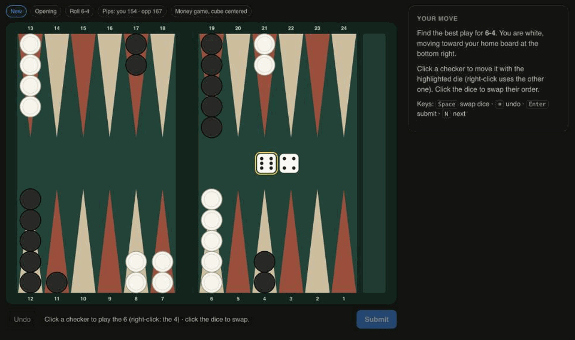
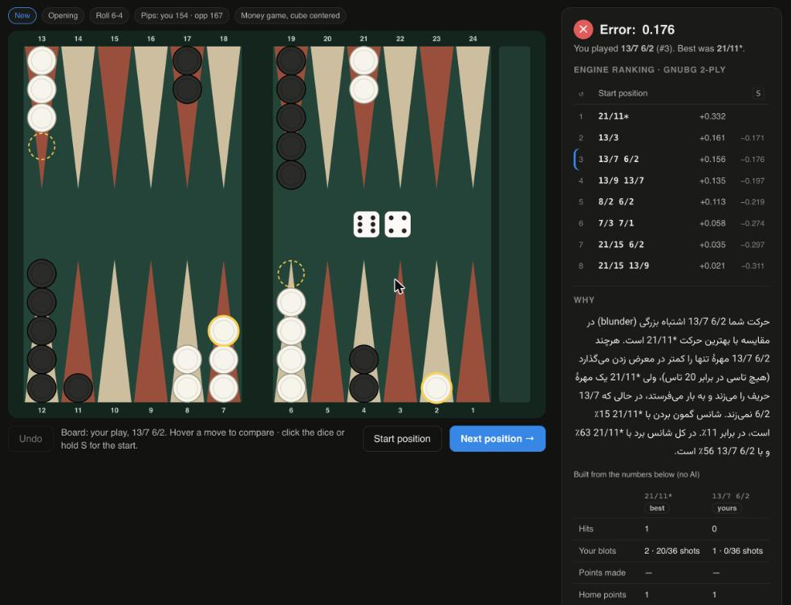
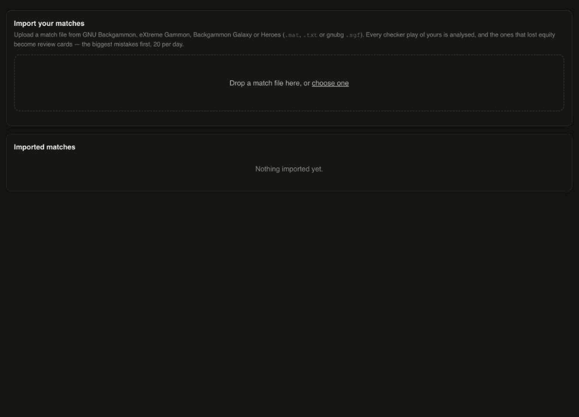
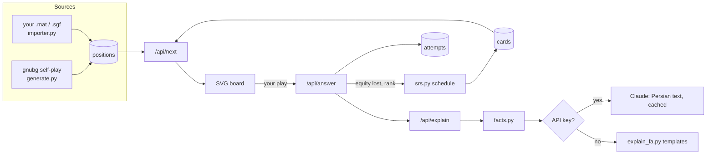

<div align="center">

# bgcoach

**A backgammon checker-play trainer that remembers your mistakes and makes you fix them.**

Positions analysed by GNU Backgammon · your own matches imported · spaced repetition · explanations in Persian

[](https://github.com/Amahdip/bgcoach/actions/workflows/ci.yml)
[](LICENSE)




</div>

---

bgcoach shows you a real position, you play it on the board, and it tells you how much
equity you lost, what GNU Backgammon would have played, and **why**. Every position you get
wrong comes back later on a spaced-repetition schedule, and you can feed it your own matches
so that the positions you train on are the ones you actually got wrong.

It started as a replacement for [bgtrain](https://github.com/gtzampanakis/bgtrain): same idea
(gnubg-analysed positions you solve one by one), but fast, without page reloads, with a
memory of your mistakes, and with explanations instead of just numbers.

> **فارسی:** bgcoach یک برنامهٔ تمرین تخته‌نرد است. پوزیشن‌ها با موتور GNU Backgammon تحلیل
> می‌شوند، هر حرکتی که اشتباه بزنید ذخیره می‌شود و با فاصله‌های زمانی (spaced repetition)
> دوباره از شما پرسیده می‌شود، می‌توانید بازی‌های خودتان را وارد کنید، و برای هر حرکت به
> فارسی توضیح داده می‌شود چرا بهترین حرکت بهتر است.

## Contents

- [Features](#features)
- [Quick start](#quick-start)
- [Using it](#using-it)
- [How it works](#how-it-works)
- [Configuration](#configuration)
- [Command-line tools](#command-line-tools)
- [HTTP API](#http-api)
- [Project layout](#project-layout)
- [Development](#development)
- [Limitations and roadmap](#limitations-and-roadmap)
- [Credits and license](#credits-and-license)

## Features

- **20,000+ real decisions** generated by gnubg self-play, filtered so every position has a
  clearly best move (the runner-up loses ≥ 0.020 equity), tagged as opening, middlegame,
  back game, race or bear-off. Generate as many more as you like (~22 per second).
- **Fair, comparable analysis.** Every legal move is scored, the top 8 at 2-ply, and any move
  you play outside the top 8 is re-scored at full depth on the spot before your error is computed.
- **Spaced repetition of your mistakes.** A missed position returns the next day, then after
  3 days, 7 days, and growing intervals. Nothing comes back the same day, when you would only be
  recognising the answer. Daily caps keep a big backlog from taking over.
- **Import your own matches** (`.mat` / `.txt` from GNU Backgammon, eXtreme Gammon, Backgammon
  Galaxy, Heroes, and gnubg `.sgf`). Your mistakes are queued for review, biggest first.
- **"Why" panel in Persian.** Exact facts computed for both plays — hits, blots and how many of
  the opponent's 36 rolls hit them, points made and given up, primes, anchors, winning and gammon
  chances — turned into a short explanation. It works offline from templates, or is written by
  Claude when an API key is configured.
- **Progress tracking.** Accuracy, average error per day and per position type, review-deck
  status and a 7-day forecast, recent mistakes one click away from practice.
- **A board that's quick to use.** Click a checker to play the highlighted die, right-click for
  the other one, click the dice (or press Space) to swap them. After answering, hover any move in
  the ranking to see it on the board — dashed ghosts where checkers left, rings where they
  landed — and hold <kbd>S</kbd> to see the starting position.
- **Small and dependency-light.** One Python process, one SQLite file, a frontend with no
  framework and no build step.

## Quick start

Requirements: **Python 3.10–3.13** (the `gnubg` wheels cover macOS arm64, Linux x86_64 and
Windows) and [uv](https://docs.astral.sh/uv/) for `run.sh`.

```bash
git clone https://github.com/Amahdip/bgcoach.git
cd bgcoach
./run.sh
```

Open <http://localhost:8000>. The first run creates `.venv`, installs the dependencies and
generates a starter database of 2,000 positions (about 1.5 minutes). For more positions:

```bash
.venv/bin/python server/generate.py --positions 18000   # ~15 minutes, safe while the server runs
```

Without uv:

```bash
python3 -m venv .venv && .venv/bin/pip install -r requirements.txt
.venv/bin/python server/generate.py --positions 2000
.venv/bin/uvicorn app:app --app-dir server --port 8000
```

## Using it

### Train

| Action | How |
|---|---|
| Move a checker with the highlighted die | click the checker (or the bar) |
| Move it with the other die | right-click |
| Swap which die is played first | click the dice, or <kbd>Space</kbd> |
| Take back the last checker move | **Undo** or <kbd>⌫</kbd> |
| Submit the play | **Submit** or <kbd>Enter</kbd> |
| See any ranked move on the board | hover it (click to pin) |
| See the starting position | **Start position**, click the dice, or hold <kbd>S</kbd> |
| Next position | **Next position**, <kbd>N</kbd> or <kbd>Space</kbd> |

You are always white, moving towards your home board at the bottom right. The filter at the
top right limits training to one kind of position (e.g. bear-offs only).



### Progress


### Import your matches

Export a match from your backgammon program as a Jellyfish text file (`.mat` / `.txt`) or, from
GNU Backgammon, as `.sgf`, drop it on the **Import** tab and pick which player you are. Each of
your checker plays is analysed (about 20 moves per second); those that lost 0.020 or more become
review cards.



## How it works



### Positions

`server/generate.py` lets gnubg play money games against itself with a little noise in its
0-ply choices, so games wander into varied, realistic positions. For every decision, all legal
moves are scored; a position is kept when the runner-up loses between 0.020 and 0.300 equity
(a real decision, but not a trivial one). Each position stores the gnubg position ID, the dice,
the full ranked move list and its kind.

### Analysis

All legal moves are scored at 0-ply and the best 8 are re-scored at 2-ply (cubeful, money game,
centred cube). Only equities from the same depth are compared: if you play a move outside the
top 8, it is evaluated at 2-ply before your error is computed and the result is saved back.

Legal moves are generated by bgcoach itself (`server/bg.py`), including the "use both dice /
use the larger die" rules; gnubg is only asked to evaluate positions. That is because
`gnubg.findbestmoves()` in the Python module truncates move tuples at the first bear-off
(`5/off 3/off` comes back as `(5,)`). The test suite checks the generator against gnubg's
move list on hundreds of self-play positions.

### Spaced repetition

A position becomes a card the first time you don't play the best move.

| Result | Next time |
|---|---|
| Missed (first time or again) | tomorrow, ease −0.2 |
| Right, 1st time after a miss | in 3 days |
| Right, 2nd time | in 7 days |
| Right after that | interval × ease (starts at 2.5) |
| Right but slower than 30 s | shorter interval, ease −0.15 |

`/api/next` serves: missed cards that are due → due reviews, biggest error first (up to 100 a
day) → queued mistakes from imported matches, biggest first (up to 20 a day) → a random position
you haven't seen. A card counts as learned once its interval reaches 3 weeks.

### Match import

`server/matchfile.py` reads Jellyfish text matches (left/right columns, `bar`/`25`, `off`/`0`,
`*` hits, `(2)` repeats, cube actions ignored) and gnubg SGF (`W[52mhlh]`-style moves). Each
recorded move is matched against the legal moves of the replayed position, so shorthand like
`24/14` or `bar/22*/18` is resolved exactly, and an illegal or unreadable move is reported with
the game and move number. Re-importing the same file is refused.

### Explanations

`server/facts.py` computes, for the best play and the play being compared (yours, or the
runner-up when you found the best one):

- hits, and opponent checkers on the bar
- your blots and **how many of the opponent's 36 rolls hit at least one**, counting only
  plays the opponent can legally make
- points made and given up, home-board points, the longest prime, anchors in the opponent's board
- checkers borne off, back checkers, pip counts
- gnubg's chances: win, win a gammon, lose a gammon

Without an API key, `server/explain_fa.py` ranks the differences by importance and writes the
2–3 that matter most as Persian sentences, plus a concession when your play was better on some
count. With `ANTHROPIC_API_KEY` set, the same facts go to Claude (`claude-opus-5-5`, with
server-side refusal fallback), which is told to use only those numbers; each text is cached in
the `explanations` table so a position is explained once. The panel always shows the facts table
and says which kind of text you are reading.

## Configuration

Copy `.env.example` to `.env`; `run.sh` loads it.

| Variable | Default | Purpose |
|---|---|---|
| `ANTHROPIC_API_KEY` | unset | Enables Claude-written explanations (otherwise templates) |
| `PORT` | `8000` | Port for `run.sh` |
| `BGCOACH_DB` | `data/bgcoach.sqlite` | Database file |

Training constants live in `server/srs.py` (`MAX_REVIEWS_PER_DAY`, `NEW_PER_DAY`,
`RELEARN`, `SLOW_MS`, `LEARNED_DAYS`) and the import threshold in `server/importer.py`
(`MIN_ERROR`). The daily caps reset at midnight UTC.

## Command-line tools

```bash
# Generate positions (all options: --help)
.venv/bin/python server/generate.py --positions 5000 [--plies 2] [--min-gap 0.02] [--max-gap 0.30]

# Import a match for a player (name exactly as in the file)
.venv/bin/python server/importer.py match.mat --player "Alice" [--user me] [--min-error 0.02]
```

## HTTP API

All endpoints take an optional `X-User` header (default `me`).

| Method | Path | Purpose |
|---|---|---|
| `GET` | `/api/next?kind=` | Next position: due card, queued import or a new one |
| `GET` | `/api/position/{id}` | A specific position (practice mode) |
| `POST` | `/api/answer` | `{position_id, result: {me, opp}, ms}` → ranking, error, card schedule |
| `GET` | `/api/explain/{id}?chosen=` | Facts + Persian explanation for the chosen move index |
| `GET` | `/api/stats` | Accuracy, daily error, deck status, forecast, mistakes, imports |
| `POST` | `/api/import/preview` | `{filename, text}` → players, games, decisions per player |
| `POST` | `/api/import` | `{filename, text, player}` → decisions, error rate, mistakes |

## Project layout

```
server/
  app.py          FastAPI app: API endpoints, serves web/
  bg.py           rules, legal moves, notation, gnubg evaluation, analyse()
  generate.py     self-play position generator
  matchfile.py    .mat / .sgf parser and replay
  importer.py     match import: analyse the user's moves, queue mistakes
  srs.py          review scheduling and daily caps
  facts.py        measurable facts about a play
  explain_fa.py   Persian explanation from templates
  explain.py      Persian explanation via the Claude API, cached
  db.py           SQLite schema and additive migrations
web/              index.html, app.js, style.css (no build step)
tests/            pytest suite; fixtures/ holds match files and the true move list
docs/             screenshots and GIFs for this README
AGENTS.md         guide for AI coding agents (CLAUDE.md points to it)
.claude/skills/   Claude Code skill for running and operating the app
```

## Development

```bash
uv venv -p 3.13 .venv && uv pip install -p .venv -r requirements-dev.txt
.venv/bin/python -m pytest -q      # 41 tests, ~5 s
node --check web/app.js
```

CI runs the tests on Python 3.11 and 3.13 for every push and pull request.

Things worth knowing before changing code (more in [AGENTS.md](AGENTS.md)):

- Boards use gnubg's format: `(opp, me)`, 25 ints each from that side's view, index 24 = bar.
- gnubg segfaults when called from any thread except the main one, so every endpoint is
  `async def`, and tests call endpoints with `asyncio.run()` rather than FastAPI's `TestClient`.
- Schema changes must be additive (`db.MIGRATIONS`): people have training history in their database.
- The database runs in WAL mode; copy it with SQLite's backup API, not `cp`.

Working with an AI agent? `AGENTS.md` has the conventions and the checks to run, and the
`bgcoach` skill in `.claude/skills/` teaches Claude Code how to run the app, generate positions,
import matches, inspect the review deck and verify UI changes.

## Limitations and roadmap

Current limits:

- **Checker play only**, analysed as a money game with a centred cube. Cube decisions and match
  score are not modelled yet; imported match positions are analysed as money play too.
- The match parser is tested against files laid out exactly as gnubg 1.08 writes them, an
  XG-style variant and gnubg SGF; real exports from Galaxy or Heroes may need small fixes
  (please open an issue with the file).
- Single user per database (`X-User` header, no login).
- gnubg runs on the event loop, which is fine for one person; a shared server should move it
  to a worker process.

Ideas for next steps:

- Cube decisions (double / take / pass) as a second kind of card
- Match-score-aware analysis for imported matches
- Rollouts for the hardest positions
- A dedicated race / bear-off generator
- Accounts and a hosted version

## Credits and license

- [GNU Backgammon](https://www.gnu.org/software/gnubg/) and the
  [`gnubg` Python package](https://github.com/StonesAndDice/gnubg-pypi) do all the evaluation.
- [bgtrain](https://github.com/gtzampanakis/bgtrain) by Giorgos Tzampanakis was the
  inspiration; no code was taken from it.

bgcoach is free software under the [GNU General Public License v3.0 or later](LICENSE), as
it builds on GNU Backgammon (GPL v2 or later).
